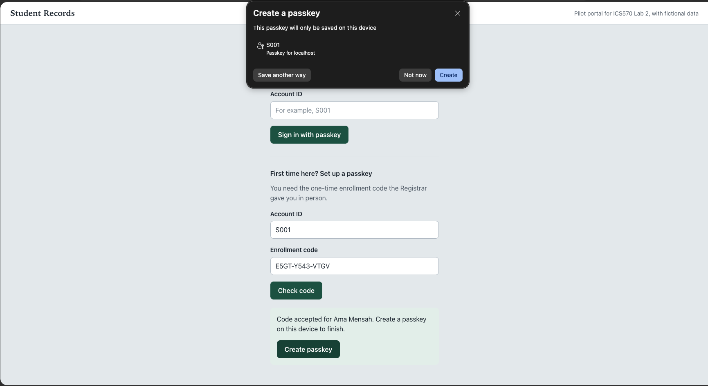
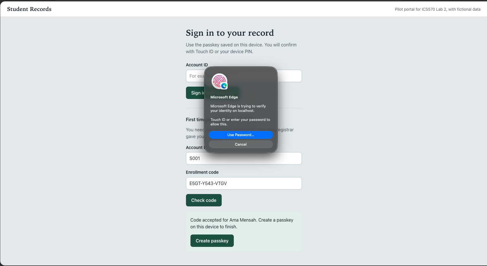
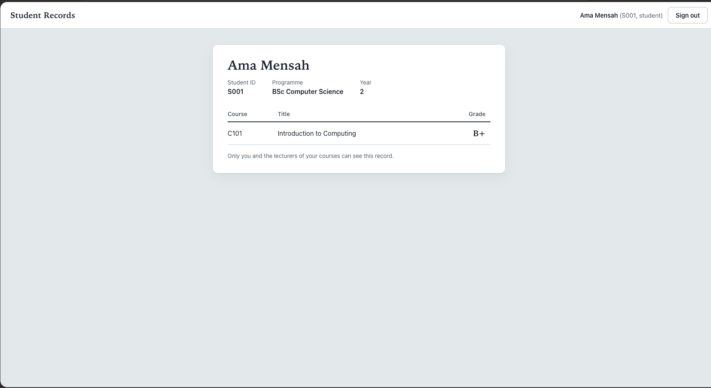
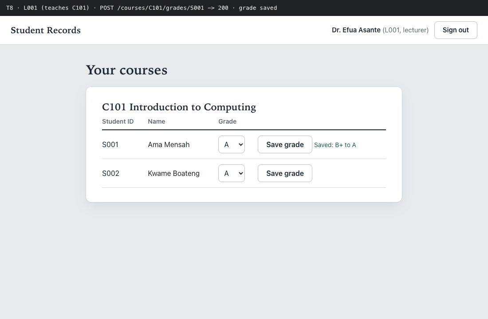
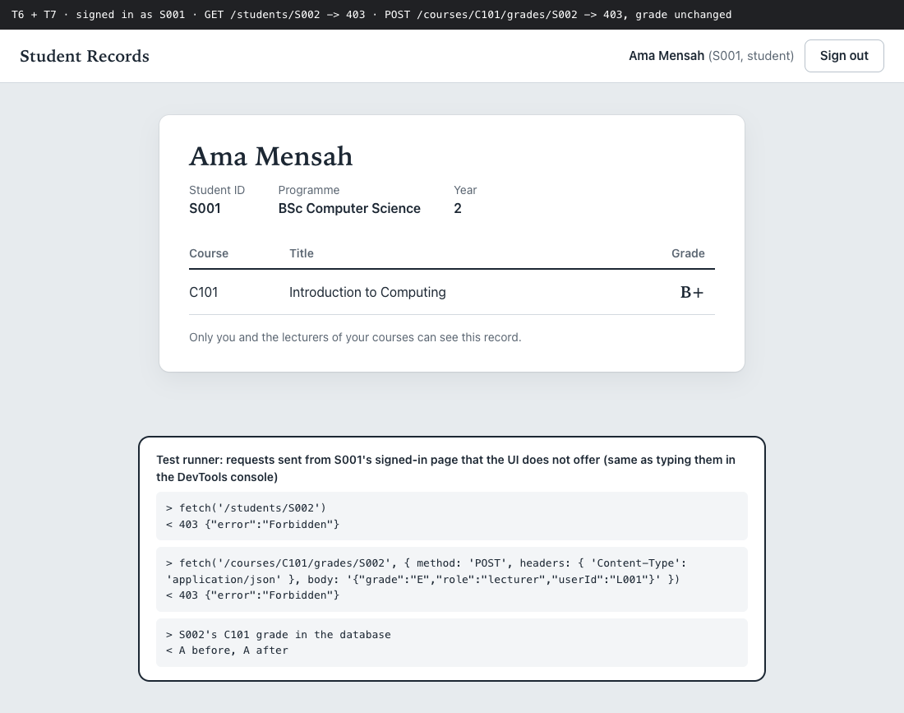
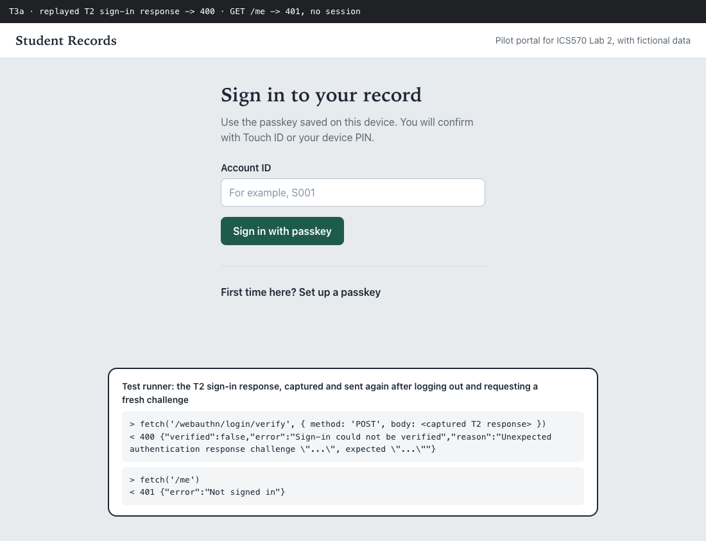

# Student Records Portal

**ICS570 Cybersecurity Essentials, Lab 2: Authentication and Access Control. Group 3.**

A small university portal where students and lecturers sign in with **passkeys** (WebAuthn/FIDO2), and the server checks **every request** against who you are and what your role allows. Students see only their own record. Lecturers change grades only in the courses they teach. Everything else is refused by the server, even if someone types the request by hand.

All data is fictional. The portal runs on your own computer at `http://localhost:3000`.

| Submission document | What it is |
| --- | --- |
| [Evidence report (PDF, 3 pages)](docs/Lab2_Evidence_Report.pdf) | Results of tests T1–T8, screenshots, the code that refused each request, the analysis and the AI declaration |
| [README (PDF, 1 page)](docs/README-1-page.pdf) | The one-page setup and test guide required by the brief ([Markdown version](docs/README-1-page.md)) |
| [Part B addendum (PDF)](docs/Lab2_PartB_Addendum.pdf) | AES-GCM encryption demo, submitted once Part B is released |
| [Evidence folder](evidence/) | Every screenshot, request log, server log and audit log from the test runs |

---

## What it looks like

**Setting up a passkey with Touch ID (T1), done by hand in Microsoft Edge on macOS**

<p>
  
  
</p>

**A student's own record after signing in (T2, T5)**



**A lecturer changing a grade in a course they teach (T8)**



**Requests the page never offers, refused by the server (T6, T7)**

Signed in as student S001, we asked for another student's record and tried to change a grade, even claiming to be a lecturer in the request. Both were refused with `403 Forbidden`, and the grade did not change.



**A stolen sign-in response cannot be reused (T3)**



---

## Run it

You need **Node.js 22.13 or newer** (`node -v`) and **Chrome, Edge or Safari** on a computer with Touch ID, Windows Hello or a security key.

```bash
git clone https://github.com/ASU-MICS-2028/cs-group-3-assignment-1.git
cd cs-group-3-assignment-1
npm ci                     # installs the exact versions in package-lock.json
cp .env.example .env       # then set SESSION_SECRET to a long random string
npm run seed               # creates the database and prints a one-time code for each account
npm start                  # open http://localhost:3000  (use "localhost", not 127.0.0.1)
```

**Test accounts**

| Account | Role | Can do |
| --- | --- | --- |
| S001 (Ama Mensah) | Student, takes C101 | See own record only |
| S002 (Kwame Boateng) | Student, takes C101 and C102 | See own record only |
| L001 (Dr. Efua Asante) | Lecturer, teaches C101 | See C101 students; change C101 grades |
| L002 (Dr. Kofi Owusu) | Lecturer, teaches C102 | See C102 students; change C102 grades |

Each code from `npm run seed` works once and expires after 24 hours. To start over, stop the server, run `npm run seed` again, then `npm start`.

**First sign-in:** open **First time here? Set up a passkey**, enter the account ID and its code, click **Check code**, then **Create passkey** and confirm with Touch ID. After that, enter the account ID and click **Sign in with passkey**.

---

## Security tests

All 16 tests passed. The full table with observed values is in [`evidence/results.md`](evidence/results.md).

| Test | Who | What we tried | Result |
| --- | --- | --- | --- |
| T1 | S001 | Register a passkey after entering the one-time code | Allowed (200); public key stored for S001 |
| T2 | S001 | Sign in with the passkey | Allowed (200); session created |
| T3a | S001 | Send a captured sign-in response again | Rejected (400); challenge already used |
| T3b | S001 | Change one character of the signature | Rejected (400); signature not verified |
| T4 | Nobody signed in | Open `/students/S001` | Denied (401) |
| T5 | S001 | Open own record | Allowed (200) |
| T6 | S001 | Open S002's record by changing the URL | Denied (403) |
| T7 | S001 | Call the lecturer's grade endpoint directly | Denied (403); grade unchanged |
| T8 | L001 | Change a C101 grade | Allowed (200); audit line written |
| X1 | L001 | Change a grade in C102, which L001 does not teach | Denied (403) |
| X2 | L001 | Open S002's record (S002 takes C101 and C102) | Only the C101 part is returned |
| X3 | Anyone | Reuse S001's enrollment code | Rejected (400) |
| X4 | Nobody signed in | Ask for passkey registration without a code | Denied (401) |
| X5 | S001 | Sign out, then open own record | Denied (401) |
| X6 | L001 | Registrar removes L001 from C101; L001 tries again while still signed in | Denied on the very next request (403) |
| X7 | S001 | Send one valid sign-in response twice at the same moment | One succeeds, one is rejected |

**Run them yourself.** Stop `npm start`, then run `npm run evidence`. It drives Chrome against a separate test database, using Chrome's built-in virtual authenticator in place of Touch ID, and writes the results, screenshots and logs to `evidence/`. Add `HEADED=1` to watch it. Steps for repeating T1–T8 by hand are in the [1-page README](docs/README-1-page.md).

---

## How it works

Every protected request passes two separate checks:

1. **Who are you?** `requireAuth` in [`server.js`](server.js) only lets through a session that was created by a verified passkey sign-in. It reads the user and role from the database, never from the request. No session gives **401**.
2. **What may you do?** Each route then asks [`policy.js`](policy.js), which denies unless a rule allows. A student may read only their own record. A lecturer may read and grade only students in a course they teach. A refusal gives **403** and is written to the audit log.

```javascript
// policy.js
function canReadStudent(user, studentId) {
  if (user.role === 'student') return user.id === studentId;            // own record only
  if (user.role === 'lecturer') return sharesCourse(user.id, studentId); // their courses only
  return false;
}
function canEditGrade(user, courseId, studentId) {
  return user.role === 'lecturer' && teaches(user.id, courseId) && isEnrolled(studentId, courseId);
}
```

**Passkeys.** The server issues a fresh, single-use challenge for every registration and sign-in. It checks the origin (`http://localhost:3000`), the relying-party ID (`localhost`), user verification (Touch ID or PIN) and the signature against the stored public key. The private key never leaves the device. Registration is only possible after entering a one-time code from the Registrar.

**Sessions.** Sessions are kept on the server. The cookie is `HttpOnly` and `SameSite=Strict`, gets a new ID at sign-in, and expires after 15 idle minutes. Sign-out destroys the session. No codes, challenges, cookies or keys are written to any log.

**Registrar console.** Account administration is deliberately not part of the website:

```bash
npm run admin -- unassign L001 C101       # end a lecturer's access to a course
npm run admin -- issue-code S001          # new enrollment code (lost-device recovery)
npm run admin -- revoke-passkeys S001     # revoke passkeys and end that user's sessions
npm run partb                             # Part B: AES-GCM encryption demo
```

## Project layout

```text
server.js          sign-in, enrollment, sessions, protected routes, logging
policy.js          every authorization rule (deny by default)
db.js              database schema (SQLite, built into Node)
config.js          relying-party settings, timeouts, grade list
public/            the web pages: sign-in, student record, lecturer roster
scripts/seed.js    fictional accounts, courses, grades and one-time codes
scripts/admin.js   Registrar console
scripts/evidence.js automated security tests T1-T8 and X1-X7
part-b/            AES-GCM encryption demo
evidence/          results, screenshots and logs from our runs
docs/              the documents submitted on Canvas
```

## Group 3

Henry Nii-Amarh Olletey, Kobina Adzeyena Opei Junior, Eric Sunu and Clifford Yeboah.

**AI use declaration:** Claude (Anthropic) was used to generate the code for the portal, including its web interface, server-side checks and automated test runner, and to help aggregate our ideas and thoughts and word our documents. Group 3 reviewed the material and takes responsibility for the work presented.
